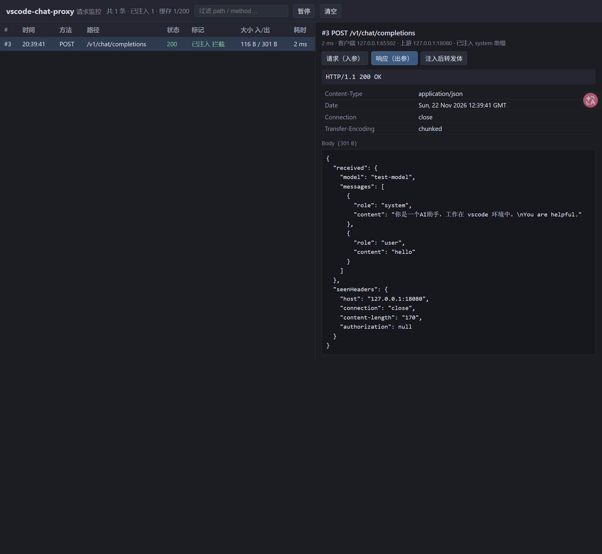

# vscode-chat-proxy

一个用 **MoonBit** 编写的本地 HTTP **正向代理（mitmproxy 用法）**：监听本地端口，
把应用的 HTTP 代理指向它，请求按**自带目标地址**转发到原服务器（无需配置上游），
并拦截所有 **URL 以 `/v1/chat/completions` 结尾的 POST 请求**（标准 Chat Completions API），
确保其 System message 的第一句是**配置里指定的话术**——默认是：

> 你是一个AI助手，工作在 vscode 环境中

这句话不是写死的：改 `.env` 里的 `SYSTEM_PROMPT`（或启动参数 `--system-prompt`）就能换成任意话术。

支持 **Windows** 和 **Linux**（macOS 也可以）。基于官方 [`moonbitlang/async`](https://github.com/moonbitlang/async)
异步运行时（Linux epoll / Windows IOCP），单进程即可并发处理多个连接，**SSE 流式响应实时透传**。
自带 **mitmweb 风格的监控页面**，可实时查看每个请求的入参 / 出参（见[监控页面](#监控页面mitmweb-风格)）。

本项目按 [MoonBit 全栈教程](https://docs.moonbitlang.cn/tutorial/fullstack-one-project.html) 组织：
**前端也是 MoonBit**（[rabbita](https://mooncakes.io/docs/moonbit-community/rabbita) Elm 架构，编译为 JS），
前后端通过 `shared/` 包里 `#derive(ToJson, FromJson)` 的契约类型通信，wire 格式只定义一次。
尽量复用 mooncakes 生态而非自研：监控 Web 服务器用
[moonback](https://mooncakes.io/docs/moonbitlang/moonback)（路由/响应helpers/连接管理），
`.env` 解析用 [spectacleCase/dotenv](https://mooncakes.io/docs/spectacleCase/dotenv)，
监控存储用 [moonsqlite](https://mooncakes.io/docs/moonbitstack/moonsqlite)（自带 SQLite amalgamation，无系统依赖）。

## 依赖（mooncakes.io）

| 包 | 用途 |
|---|---|
| `moonbitlang/async` | 异步运行时 + TCP socket（代理数据面、SSE 透传） |
| `moonbitlang/moonback` | 监控 Web 服务器：路由（含 `:id` 参数）、JSON/文本响应、连接管理 |
| `moonbit-community/rabbita` | 监控前端 Elm 架构 UI 框架（js 目标） |
| `spectacleCase/dotenv` | `.env` 文本解析（引号/export/行内注释/BOM/容错） |
| `moonbitstack/moonsqlite` | 嵌入式 SQLite（自带 amalgamation，native 目标） |

自研部分只保留生态里没有的：代理数据面（TCP 级转发 + system 前缀注入）、
流量捕获 SQLite 存储、以及把前端产物内嵌进单二进制的构建脚本。

## 工作模式：正向代理（默认）与反向代理

**正向代理（mitmproxy 用法，默认）**：不配置上游。把应用/系统的 HTTP 代理设为
`http://127.0.0.1:8787`，代理从每个请求自身解析目标地址并转发：

- `POST http://host:port/v1/... HTTP/1.1`（absolute-form，`curl -x` / 多数 HTTP 客户端代理模式）→ 按 URL 里的 host:port 转发；
- `GET /v1/... HTTP/1.1` + `Host: host:port`（origin-form）→ 按 `Host` 头转发；
- `CONNECT host:443 HTTP/1.1`（HTTPS）→ 建立**盲隧道**双向透传字节。TLS 端到端加密，
  **不做 MITM，故 HTTPS 的 body 无法检查/改写**；监控只记录该连接与上下行字节数。
  如需改写 HTTPS 请求，请让客户端走明文 HTTP 到代理，或改用反向代理模式指向明文上游。

**反向代理（可选）**：加 `--upstream host:port`（或 `.env` 的 `UPSTREAM_HOST/PORT`）后，
所有请求固定转发到该上游（忽略请求自带目标），即旧版行为；客户端把 API Base URL 指向代理即可。
`.env` 已固定上游时可用 `--forward` 强制回到正向模式。

## 拦截规则

拦截是一个**开关**：默认开；可用 `--intercept off` / `--no-intercept` / `.env` 的 `INTERCEPT=off`
以纯透传模式启动，也可在**监控页面点「拦截:开/关」按钮运行中切换**（`PUT /api/intercept`，
无需重启）。关闭时所有请求原样转发，不做任何改写。

开启时对 `POST */v1/chat/completions`（忽略 query string，支持路径带前缀如 `/openai/v1/chat/completions`）。
下表的「配置话术」指 `.env` 里 `SYSTEM_PROMPT` 的值，默认 `你是一个AI助手，工作在 vscode 环境中`：

| 请求体情况 | 处理 |
|---|---|
| 第一条 `role:"system"` 消息的内容**以配置话术开头**（允许前导空白，后面可接其他内容） | 原样放行 |
| 有 system 消息但开头不是配置话术 | 在该内容**最前面**加上 `配置话术 + 句号` + 换行，其余内容保留 |
| 没有任何 system 消息 | 在 `messages` 数组**最前面插入**一条 `{"role":"system","content":"<配置话术>。"}` |
| system 的 content 是多模态数组（`[{type:"text",...},...]`） | 检查/改写第一个 `text` 片段；没有 text 片段则插入一个 |
| 请求体不是合法 JSON | 原样转发（日志给出警告） |

> 句号的处理：配置话术若已以 `。．！？；：…` 或 `.!?;:` 结尾就不再追加；否则
> 以 ASCII 结尾的补 `.`，以中文结尾的补 `。`。配置话术为空/纯空白时回退到默认那句。

其他请求（GET、其他路径、其他方法）**全部原样透传**，不做任何修改。

转发时会自动：正向模式保留原 `Host`、反向模式重写 `Host` 为上游地址；按改写后的_body_重算 `Content-Length`、
支持 `Transfer-Encoding: chunked` 请求体解码、处理 `Expect: 100-continue`、
丢弃 hop-by-hop 头（含 `Proxy-Connection`/`Proxy-Authorization`）、
强制 `Connection: close`（每个连接处理一个请求，客户端会自动重连，不影响使用）。

## 快速开始

只需要 MoonBit 工具链（`moon` 已安装即可；native 目标另需 C 编译器，Windows 上用 MSVC。
SQLite 已随程序静态编译，**无需安装 SQLite**）。

```bash
cd vscode-chat-proxy

# 1. 创建用户配置（参考 moonbit_claude_proxy 的 .env 模式）
cp .env.example .env        # Windows PowerShell: Copy-Item .env.example .env
# 按需编辑 .env 里的 HOST / PORT / UPSTREAM_HOST / UPSTREAM_PORT / SYSTEM_PROMPT

# 2. 运行（默认 native 目标，自动读取 .env；需要 C 编译器 / MSVC）
moon run cmd/main
```

也可以不用 `.env`，直接命令行指定：

```bash
# 正向代理（默认，无需上游）：把应用 HTTP 代理指向 127.0.0.1:8787
moon run cmd/main -- --listen 127.0.0.1:8787

# 反向代理（固定上游）：
moon run cmd/main -- --listen 127.0.0.1:8787 --upstream 127.0.0.1:8080
```

- `--listen` / `-l`：本地监听地址，默认 `127.0.0.1:8787`
- `--upstream` / `-u`：固定上游（反向代理模式）；**省略则为正向代理（默认）**
- `--forward` / `-f`：强制正向模式（覆盖 `.env` 里固定的上游）
- `--web` / `-w`：监控页面地址，默认 `127.0.0.1:8788`（`--web off` 或 `--no-web` 关闭）
- `--system-prompt` / `-s`（别名 `--prompt`）：注入的 system 第一句，默认 `你是一个AI助手，工作在 vscode 环境中`
- `--help` 查看帮助

**正向模式**下把客户端的 HTTP 代理指向代理，例如：

```bash
curl -x http://127.0.0.1:8787 http://your-api:8080/v1/chat/completions ...
# 或环境变量 HTTP_PROXY=http://127.0.0.1:8787 / VSCode 的 http.proxy 设置
```

**反向模式**下把客户端的 API Base URL 指向代理，例如：

```
原来: http://127.0.0.1:8080/v1
现在: http://127.0.0.1:8787/v1
```

## 用户配置（.env）

启动时自动加载**工作目录**下的 `.env`（不存在则跳过），格式与 `moonbit_claude_proxy` 一致：
`KEY=VALUE`、`#` 注释、空行、引号包裹的值、`export` 前缀、行内注释。
**已存在的环境变量不会被 `.env` 覆盖。**

**优先级：命令行参数 > 真实环境变量 > `.env` > 默认值**（已实测验证）。

| 变量 | 说明 | 默认值 |
|---|---|---|
| `HOST` | 本地监听主机 | `127.0.0.1` |
| `PORT` | 本地监听端口 | `8787` |
| `UPSTREAM_HOST` | 固定上游主机（**设置即切换反向模式**；不设=正向） | 未设置 |
| `UPSTREAM_PORT` | 固定上游端口（明文 HTTP） | 未设置 |
| `WEB_HOST` | 监控页面主机 | `127.0.0.1` |
| `WEB_PORT` | 监控页面端口 | `8788` |
| `SYSTEM_PROMPT` | 注入到 system 消息第一句的话术（`VSCODE_CHAT_PROXY_SYSTEM_PROMPT` 是等价别名；空白值回退默认） | `你是一个AI助手，工作在 vscode 环境中` |
| `INTERCEPT` | 拦截开关初始值（`on/off/1/0/true/false`；`VSCODE_CHAT_PROXY_INTERCEPT` 等价别名）；运行中可在监控页切换 | `on` |
| `VSCODE_CHAT_PROXY_LISTEN` | 组合写法 `host:port`，优先于 `HOST`/`PORT` | 未设置 |
| `VSCODE_CHAT_PROXY_UPSTREAM` | 组合写法 `host:port`（支持 `[ipv6]:port`），优先于 `UPSTREAM_HOST`/`UPSTREAM_PORT` | 未设置 |

`.env` 已加入 `.gitignore`（不会提交），模板见 [.env.example](.env.example)。

### 示例

```bash
# 上游是你的 API 网关（one-api / sub2api / new-api 等），监听 8080
moon run cmd/main -- -l 127.0.0.1:8787 -u 127.0.0.1:8080

# 用命令行临时换一句注入话术（等价于 .env 里写 SYSTEM_PROMPT=...）
moon run cmd/main -- -l 127.0.0.1:8787 -u 127.0.0.1:8080 -s "你是代码审阅助手"

# 测试：没有 system 消息的请求会被自动插入
curl http://127.0.0.1:8787/v1/chat/completions \
  -H 'Content-Type: application/json' \
  -d '{"model":"gpt-4o","messages":[{"role":"user","content":"你好"}]}'
```

代理日志会显示每个拦截请求的处理结果（`injected system prefix` / `system prefix ok, pass through`）。

## 监控页面（mitmweb 风格）

启动后浏览器打开 **http://127.0.0.1:8788**（地址随 `--web` / `WEB_HOST` / `WEB_PORT` 变化）：




页面本身是 MoonBit 全栈应用：`frontend/` 用 rabbita 的 Elm 架构（model/update/view +
`@sub.every` 轮询订阅 + `@rhttp.expect_json` 类型化请求）编译成 JS，由后端在
`GET /frontend.js` 提供；`GET /` 提供 HTML 外壳。后端 Web 层用 moonback 框架
（`ctx.get("/api/flows/:id", …)` 路由参数、`res.send_json` 等），不再手写 HTTP 服务 plumbing。
前后端共用 `shared/` 的
`FlowSummary` / `FlowsResponse` / `FlowDetail` 等契约类型（`#derive(ToJson, FromJson)`），
改一处字段两端自动同步。构建产物内嵌进 `web_assets.mbt`（由 `tools/build_web.mbtx`
生成并提交），因此**部署仍是单个可执行文件**，无需附带前端文件。

- **请求列表**：所有经过代理的请求（含非拦截路径），1.5 秒自动刷新；
  显示时间 / 方法 / 路径 / 状态码 / 入出大小 / 耗时，`已注入` / `拦截` 标记，
  支持路径过滤、暂停刷新、一键清空。
- **详情面板**：点击任意请求查看
  - **请求（入参）**：请求行、全部请求头、原始请求体（JSON 自动美化）；
  - **响应（出参）**：状态行、全部响应头、响应体；**SSE 流式响应完整捕获并自动去除 chunked 分块 framing**；
  - **注入后转发体**：被注入前缀的请求额外提供此页签，对比实际发给上游的 body。
- 进行中的请求（如正在输出的 SSE）实时显示为「进行中」，完成后自动补全出参。
- 数据落在**系统临时目录**里的单个 SQLite 文件中：
  - Windows：`%TEMP%\vscode-chat-proxy-monitor-<WEB_PORT>\monitor.sqlite`
  - macOS / Linux：`$TMPDIR`（未设置时 `/tmp`）`/vscode-chat-proxy-monitor-<WEB_PORT>/monitor.sqlite`
  - 可用 `MONITOR_DIR`（或 `VSCODE_CHAT_PROXY_MONITOR_DIR`）覆盖；启动日志会打印实际目录。
  - 原生目标内嵌 SQLite（`moonbitstack/moonsqlite`，编译进可执行文件），**无需系统安装 SQLite**。
- 最多保留最近 **200** 行；每个 body 最多保存 **256 KiB**（超出截断并标注）。
  **重启后自动加载历史**；超过 200 行时删除最旧的行，`auto_vacuum` 会回收空间。
- 数据库按 `0600` 创建（Windows 忽略权限位），但临时目录里的内容仍可能含 API Key。
  清理交给系统临时目录策略（Windows 的 `%TEMP%` 不保证自动清理），也可随时手动删除或点「清空」。
- `--no-web`（或 `--web off`）不启用监控页面，也不落盘，只在内存里保留最近 200 条。

JSON API（页面即基于此实现，可自行脚本化）：

| 端点 | 说明 |
|---|---|
| `GET /` | 监控页面 HTML 外壳 |
| `GET /frontend.js` | MoonBit 前端构建产物（内嵌） |
| `GET /api/flows` | 请求列表 + 统计（total / injected_total / stored / capacity） |
| `GET /api/flows/<id>` | 单条详情（请求头/体、注入后 body、响应头/体） |
| `DELETE /api/flows` | 清空列表并删除已落盘的数据文件 |

JSON 契约见 `shared/types.mbt`；可选字段（`error` / `upstream_request` / `response`）
为 None 时**省略键**，Some 时直接是值（MoonBit derive 的 Option 编码约定）。

> ⚠️ 监控页面默认只绑定 `127.0.0.1`。请求体/响应体可能含 API Key 等敏感信息，
> 不要把 `WEB_HOST` 设成 `0.0.0.0` 暴露到公网。

## 构建独立可执行文件（Linux 推荐）

```bash
moon build --target native --release
# 产物: _build/native/release/build/cmd/main/main.exe   （Linux 下就是 ELF 可执行文件）
./_build/native/release/build/cmd/main/main.exe -l 0.0.0.0:8787 -u 127.0.0.1:8080
```

- **Linux**：native 目标需要 gcc / clang（发行版自带即可），已在 OpenCloudOS 9 + gcc 12 实测通过。
- **Windows**：native 目标需要 **MSVC**（VS Build Tools 的「使用 C++ 的桌面开发」工作负载，
  含 Windows SDK；MinGW 不支持）。安装（管理员 PowerShell，约 10–30 分钟）：

  ```powershell
  # 下载引导器后执行（会弹 UAC）：
  .\vs_buildtools.exe --add Microsoft.VisualStudio.Workload.VCTools --includeRecommended --quiet --wait --norestart
  ```

  装好后 `moon build --target native --release` 直接产出 Windows exe，
  已在 Windows 11 + MSVC v143 实测通过。moon 会自动探测 MSVC 环境，无需手动配置。
  SQLite 已随程序静态编译，不需要额外安装。
- 后端只支持 **native**（监控存储使用嵌入式 SQLite）；前端仍是 MoonBit JS，构建时内嵌。
  不再提供 wasm 后端产物。
- **部署**：独立二进制 + 同目录 `.env` 即可运行（与 `moonbit_claude_proxy` 相同），
  无需 MoonBit 工具链；`.env` 从**进程工作目录**读取。前端资源和 SQLite 都已内嵌。

### 修改监控前端后

```bash
moon run tools/build_web.mbtx   # 构建 frontend(js) 并重新生成内嵌的 web_assets.mbt
moon test frontend --target js  # 前端 update 逻辑单测
```

生成的 `web_assets.mbt` 需随源码一起提交（下游使用者不执行构建脚本）。

## 测试

```bash
moon test                 # 51 个后端/契约单元测试（native）
moon test frontend --target js  # 7 个前端 Elm update 逻辑测试
moon check --target native  # 后端类型检查

# 端到端测试：先起一个 mock 上游（需要 Node.js）
node test/mock-upstream.mjs 18080
moon run cmd/main -- -l 127.0.0.1:18787 -u 127.0.0.1:18080
# 然后向 18787 发请求，mock 会把收到的请求体原样返回，便于核对改写结果
```

已验证场景（Windows 11 + MSVC 与 Linux native）：
无 system 插入、已有前缀放行、其他 system 文本前置注入、多模态 content、
自定义 `SYSTEM_PROMPT` / `--system-prompt` 话术（含英文话术与自带句末标点）、
SSE 流式透传、chunked 请求体、GET/其他路径透传、`Authorization` 等头部保留、
`.env` 加载与「命令行 > 环境变量 > .env」优先级、
监控页面列表/详情/注入对比/SSE 出参捕获（浏览器实测）。

## 项目结构

按 MoonBit 包组织惯例分层（facade + 公共包 + internal 实现包，
参考 `moonbitlang/async`、rabbita 与全栈教程的结构）：

```
moon.pkg / facade.mbt   # 根 facade：pub using 再导出各层公共 API（旧导入路径兼容）
shared/                 # 前后端共享 API 契约类型（#derive(ToJson, FromJson)）
proxy/                  # 代理核心：system 前缀注入 + 连接处理/转发/捕获
monitor/                # 监控层：Flow/FlowStore（系统临时目录 SQLite 持久化）、chunked 解码、
                        #   moonback Web 服务器与 JSON API、内嵌资源 web_assets.mbt
config/                 # 配置层：Config、命令行/环境变量解析
internal/httpparse/     # 实现支持：代理数据面的 HTTP 解析/请求头重建
internal/dotenv/        # 实现支持：.env 异步读取 + 不覆盖已有环境变量
                        #   （解析委托 spectacleCase/dotenv）
frontend/               # 监控前端：rabbita Elm 架构（js 目标）+ update 单测
web/index.html          # 监控页面 HTML 外壳（CSS + 挂载点）
tools/build_web.mbtx    # 构建前端并生成 monitor/web_assets.mbt（.mbtx 自动化）
cmd/main/               # 入口：load_env → 配置 → 任务组并发跑代理与监控
.env.example            # 用户配置模板（复制为 .env 使用）
test/                   # mock 上游（Node.js）+ 监控页面截图
```

依赖方向：`cmd/main → facade → {proxy, monitor, config} → {shared, internal/*}`；
`frontend → shared`。internal 包只放实现支持（解析器/加载器），
带方法的公共类型（`Config`/`Flow`/`FlowStore`）都在公共包，保证 facade
再导出后外部仍可正常调用方法。各层测试随包放置（`*_test.mbt` / `*_wbtest.mbt`）。

## 已知限制

- 上游必须是 **HTTP**（明文）。如需代理 HTTPS 上游，可在上游侧放一个 TLS 终结
  （如 nginx/stunnel），或让客户端继续直连 HTTPS、仅把本地 HTTP 网关挂在代理后面。
- 不支持 `CONNECT`（HTTPS 隧道）与 WebSocket/`Upgrade` 请求（分别返回 405/501）。
- 每个连接只处理一个请求（`Connection: close`）；对 API 调用场景无实际影响。
- 请求体缓冲上限 64 MiB。
- 只检查**第一条** system 消息；`developer` role 不视为 system。
- 监控数据存系统临时目录的 SQLite 文件（最近 200 行、每 body 256 KiB），重启后自动加载；
  临时目录被系统清理时历史会丢失。被代理拒绝的请求（CONNECT/Upgrade/坏请求行）不进监控列表。